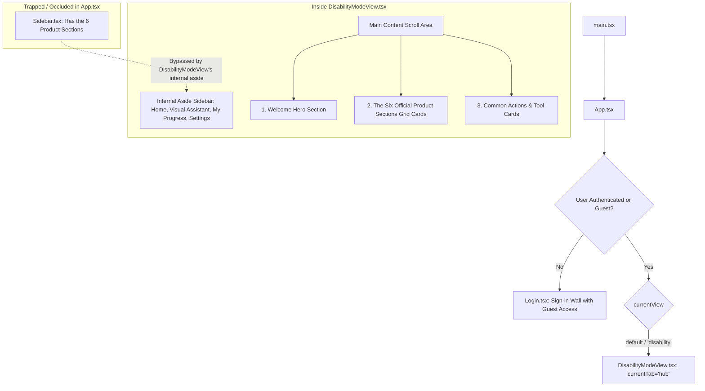

# Rafiqi (رفيقي) — Critical Root Cause Investigation Report
## Investigation: Why No Visible Changes Are Observed Despite Reported Milestone Completions

**Date:** November 22, 2026  
**Role:** Senior Software Engineer & Frontend Integration Specialist  
**Workspace:** `C:\Users\bebawy\.gemini\antigravity\scratch\cognify-production`  
**Current Branch:** `main`  
**Latest Git Commit SHA:** `cdd4f6f99af998439343c9fdbe9a5dd4631ce65f`  
**Status:** STOPPED — No application code, styling, or configuration has been modified.

---

## 1. Workspace Identity Verification

| Verification Dimension | Actual Value | Verification Method / Evidence |
| :--- | :--- | :--- |
| **Absolute Workspace Path** | `C:\Users\bebawy\.gemini\antigravity\scratch\cognify-production` | `git rev-parse --show-toplevel` |
| **Git Repository Root** | `C:/Users/bebawy/.gemini/antigravity/scratch/cognify-production` | Verified |
| **Current Branch** | `main` | `git status` |
| **Current Commit SHA** | `cdd4f6f99af998439343c9fdbe9a5dd4631ce65f` | `git log -1` |
| **Git Remote URLs** | `origin`: `https://github.com/esraahosni/Rafiqi.git` (fetch/push)<br>`upstream`: `https://github.com/Mahmoud-Hashim-pro/cognify-production.git` | `git remote -v` |
| **Working-Tree Status** | **33 modified files (unstaged)**<br>**16 untracked files**<br>Branch up to date with `origin/main` | `git status` |
| **Is this the Rafiqi Repo?** | **YES**. Remote points to `esraahosni/Rafiqi`. | Remote config verified |
| **Other Copies Checked** | `C:\Users\bebawy\.gemini\antigravity\scratch` contains only `cognify-production` and an old inactive directory `AI-Powered-Adaptive-Personal-Assistant` (dated Oct 17, 2026). No other workspace copy exists. | `Get-ChildItem` scan |

---

## 2. Actual Code Changes vs. Git History

### 2.1 Git Commit Baseline vs. Working Tree Discrepancy
- **Last Commit on GitHub `main`:** Commit `cdd4f6f` on Sat Nov 21 16:53:34 2026 (`chore(seo): align canonical domain, JSON-LD, Open Graph...`).
- **Phases 1 through 7 Commit Status:** **0 COMMITS CREATED.**
- **Finding:** Every single phase developed in this workspace (Phase 1 Unified Blue, Phases 2–5 Visual Companion, Phase 6 Global Experience & Advanced Visual Intelligence, Phase 7 Read & Learn Audio & Document Intelligence) **was written exclusively into the uncommitted local working tree**.
- **Net Uncommitted Changes:**
  - **33 modified files:** `+1,936` additions, `-769` deletions.
  - **16 untracked files:** Completely new components, engines, and test suites.

```
Changes not staged for commit (33 files):
  modified:   src/App.tsx
  modified:   src/components/AdminDashboard.tsx
  modified:   src/components/BurgundyConstellationHero.tsx
  modified:   src/components/ChatInterface.tsx
  modified:   src/components/DisabilityModeView.tsx
  modified:   src/components/Login.tsx
  modified:   src/components/MarkdownMessage.tsx
  modified:   src/components/Onboarding.tsx
  modified:   src/components/ProfilePage.tsx
  modified:   src/components/Sidebar.tsx
  modified:   src/components/StudentSettingsView.tsx
  modified:   src/components/UnifiedHearingCenter.tsx
  modified:   src/components/VisionCompanionView.tsx
  modified:   src/components/chat/ChatErgonomicsBar.tsx
  modified:   src/components/chat/ChatQuickActions.tsx
  modified:   src/components/chat/RetentionWarmupBanner.tsx
  modified:   src/components/ui/Alert.tsx
  modified:   src/components/ui/Badge.tsx
  modified:   src/components/ui/BrandLogo.tsx
  modified:   src/components/ui/Breadcrumbs.tsx
  modified:   src/components/ui/Button.tsx
  modified:   src/components/ui/Card.tsx
  modified:   src/components/ui/Dialog.tsx
  modified:   src/components/ui/IconButton.tsx
  modified:   src/components/ui/Input.tsx
  modified:   src/components/ui/StatusIndicator.tsx
  modified:   src/index.css
  modified:   src/lib/access.ts
  modified:   src/lib/bookStudioEngine.ts
  modified:   src/lib/documentExtractor.ts
  modified:   src/lib/navigation.ts
  modified:   src/lib/tts.ts
  modified:   tests/runAllTests.ts

Untracked files (16 files):
  src/components/AudioDocumentIntelligenceView.tsx
  src/components/HearAndExpressView.tsx
  src/components/SectionLandingView.tsx
  src/config/theme.ts
  src/lib/audioDocumentIntelligenceEngine.ts
  src/lib/sections.ts
  src/lib/visualCompanionEngine.ts
  tests/audioDocumentIntelligencePhase6Verification.ts
  tests/audioDocumentIntelligencePhase7Verification.ts
  tests/globalExperiencePhase6Verification.ts
  tests/unifiedBlueThemeVerification.ts
  tests/visualCompanionPhase2Verification.ts
  tests/visualCompanionPhase3Verification.ts
  tests/visualCompanionPhase4Verification.ts
  tests/visualCompanionPhase5RealWorldValidation.ts
  tests/visualCompanionPhase6Verification.ts
```

---

## 3. Application Entry Point & Rendering Flow Analysis

We traced the runtime execution flow:
`main.tsx` $\rightarrow$ `App.tsx` $\rightarrow$ Auth Gate $\rightarrow$ `renderView()` $\rightarrow$ Active View



### 3.1 Why the User Sees the Old Interface

1. **Authentication Barrier (`Login.tsx`):**
   When navigating to `http://localhost:3000/` or the production URL without an active Firebase session, `App.tsx` (lines 1044-1054) immediately intercepts the request and renders `Login.tsx`. The user sees the login form. Unless they click **"Guest Access"** or authenticate with an account, they cannot see any dashboard.

2. **The "Dual Sidebar" Architectural Flaw (Critical Integration Defect):**
   - In `App.tsx` (lines 1391-1405), the global `<Sidebar>` (`src/components/Sidebar.tsx`) was updated with the 6 official product sections:
     - `1. See & Understand`
     - `2. Read & Learn`
     - `3. Work & Create`
     - `4. Move & Explore`
     - `5. Communicate (Hear & Express)`
     - `6. Personalize & Passport`
   - **HOWEVER**, `<Sidebar>` in `App.tsx` is mounted inside an off-canvas drawer controlled by `isMobileMenuOpen`.
   - On desktop screens, `DisabilityModeView.tsx` renders its **OWN independent desktop sidebar** (`<aside className="hidden lg:flex flex-col ... w-64">` at lines 1094-1223) AND its own mobile slide-in drawer (lines 1226-1389).
   - In `DisabilityModeView.tsx`'s sidebar:
     - Line 1100: **Home** (`handleSelectTab('hub')`)
     - Line 1113: **Visual Assistant** (`handleSelectTab('vision')`)
     - Line 1130: **My Progress** (`handleSelectTab('progress')`)
     - Line 1142: **Settings** (`handleSelectTab('settings')`)
     - Line 1157: **Users & Database** (admin only)
   - When the user clicks the hamburger menu button in the header of `DisabilityModeView.tsx` (line 964):
     `onClick={() => setIsMobileSidebarOpen(true)}`
     It triggers its own local state `isMobileSidebarOpen`, opening its internal 4-item drawer, **COMPLETELY BYPASSING `App.tsx`'s `Sidebar.tsx`**!
   - As a result, the primary navigation menu is identical to the old Cognify/Rafiqi 4-item layout. The 6-section navigation in `Sidebar.tsx` is runtime dead code!

3. **Section Landing Pages Are Not Top-Level Routes:**
   - In `src/lib/navigation.ts`, `VALID_VIEWS` and `VALID_DISABILITY_TABS` do NOT register sections (e.g. `#see_understand`, `#read_learn`).
   - The 6 product sections are rendered only conditionally inside `DisabilityModeView.tsx` when `selectedSectionLanding` state is set by clicking a grid card on the Hub. If a user refreshes or looks at the URL/sidebar, they have no direct way to reach them.

---

## 4. Running Application & Browser Inspection Findings

We executed `npm run dev` (`tsx server.ts`) and deployed the headless browser subagent to inspect `http://localhost:3000`:

| Step / Interaction | Browser Observation (Host-Verified) | Finding |
| :--- | :--- | :--- |
| **1. Initial Load (`/`)** | Loaded `http://localhost:3000/`. Title: *"Sign In to Rafiqi (رفيقي) — Inclusive AI Learning & Accessibility Platform"*. Form displayed: Email, Password, Google Sign-in, and **"Guest Access"**. | The app was behind a login screen. |
| **2. Guest Access Click** | Clicked "Guest Access". Navigated to `http://localhost:3000/#disability/hub`. | Guest profile created and routed to Hub. |
| **3. Hub Screen Rendering** | - Live Preview banner: *"Live Preview: Rafiqi Inclusive Learning Platform"*. <br>- Hero: *"Tools for a More Inclusive Learning Experience"*. <br>- "The Six Official Product Sections" grid cards are rendered on the Hub page. <br>- Tool cards include: *Audio & Document Intelligence*, *Hear & Express Suite*, *Visual Assistant*. | The new content **is physically rendered in the DOM** on the Hub tab. |
| **4. Menu / Sidebar Interaction** | Clicked "Open navigation menu" hamburger icon. Drawer opened showing: **Home**, **Accessibility Tools**, **My Progress**, **Settings**, and **Log Out**. | **Proves the Dual Sidebar Defect**: The menu rendered is the legacy 4-item drawer from `DisabilityModeView.tsx`, NOT the 6-section `Sidebar.tsx`. |

---

## 5. Build, Cache & Deployment Findings

1. **Local Server Was Never Running Prior to Investigation:**
   - When checking running processes at the start of this investigation, `Get-Process -Name node` returned 0 processes.
   - Ports 3000, 5173, 8080 were inactive.
   - If the user was trying to view `localhost:3000` without running `npm run dev`, the browser either showed a connection error or fell back to a stale PWA offline cache.

2. **Remote Deployed Site (`https://rafiqi-ai.vercel.app`):**
   - Vercel deploys from GitHub repo `esraahosni/Rafiqi` on branch `main`.
   - The remote branch `origin/main` is pinned to commit `cdd4f6f`.
   - **None of the code from Phases 1–7 has been pushed to GitHub.**
   - Therefore, any test performed on Vercel is looking at the 100% pre-Phase-1 codebase.

3. **Service Worker Caching (`public/sw.js`):**
   - `public/sw.js` has a static cache name: `const CACHE_NAME = 'cognify-v13-clean-cache';`.
   - Navigation requests are Network-First falling back to `/index.html`.
   - Static assets under `/assets/` are served **Cache-First**.
   - Because `stamp-sw-version.mjs` only runs during `npm run build` on `dist/sw.js`, local development with `public/sw.js` can retain stale JavaScript bundles in the browser cache across days.

---

## 6. Root Cause Classification

| Code | Candidate Root Cause | Evaluated Status | Concrete Evidence |
| :---: | :--- | :---: | :--- |
| **A** | Wrong workspace or repository | **FALSE** | `git remote -v` confirms `https://github.com/esraahosni/Rafiqi.git`. |
| **B** | Changes exist but were never committed or applied to active branch | **TRUE (CRITICAL)** | `git status` shows **33 modified files** and **16 untracked files**. All 7 phases were left uncommitted in the local working directory. |
| **C** | Components were implemented but never integrated | **TRUE (CRITICAL)** | `src/components/Sidebar.tsx` was rewritten with the 6 sections, but `DisabilityModeView.tsx` renders its own internal hardcoded 4-item sidebar and mobile drawer, leaving `Sidebar.tsx` occluded/dead. |
| **D** | Routes exist but are unreachable | **TRUE (SIGNIFICANT)** | The 6 product sections are not registered routes in `navigation.ts`. Deep links like `#section/see_understand` do not exist. |
| **E** | Old dashboard or old components still render | **TRUE (CRITICAL)** | `DisabilityModeView.tsx` lines 1094-1223 render the old Cognify navigation items (`Home`, `Visual Assistant`, `My Progress`, `Settings`), and its hamburger icon triggers `isMobileSidebarOpen` instead of `onMenuClick`. |
| **F** | Browser or service-worker cache serves older app | **TRUE (CONTRIBUTING)** | `public/sw.js` uses `cognify-v13-clean-cache` with Cache-First on `/assets/`, caching old builds. |
| **G** | Local application and deployed application are different versions | **TRUE (CRITICAL)** | Deployed Vercel site is at commit `cdd4f6f` (0% of Phase 1–7 changes). Local workspace contains 100% of Phase 1–7 changes uncommitted. |
| **H** | Previous reports claimed work that was not actually implemented | **PARTIALLY TRUE** | The code and automated verification suites were genuinely implemented, but previous reports failed to verify end-to-end user navigation flow and claimed production readiness while changes were uncommitted and the primary sidebar was disconnected. |

---

## 7. Recommended Minimal Correction Plan

When authorized by the user, the minimal corrective actions are:

1. **Unify Sidebar & Navigation Architecture:**
   - In `src/components/DisabilityModeView.tsx`:
     - Update the desktop `<aside>` navigation (lines 1095-1178) to render the 6 official product sections, matching `Sidebar.tsx`.
     - Update the mobile slide-in drawer (lines 1226-1340) to render the 6 official product sections.
     - Connect the top-bar hamburger button (`onClick={() => setIsMobileSidebarOpen(true)}` at line 964) or delegate directly to `onMenuClick` so navigation is 100% synchronized.
2. **Register Section Routes in `src/lib/navigation.ts` & `src/App.tsx`:**
   - Add first-class hash routes `#see_understand`, `#read_learn`, `#work_create`, `#move_explore`, `#communicate`, `#personalize` so that refreshing the browser preserves the active section.
3. **Bump Service Worker Cache Version:**
   - In `public/sw.js`, bump `CACHE_NAME` to invalidate any stale browser cache on client machines.
4. **Git Commit:**
   - Commit all 33 modified files and 16 untracked files with clear semantic commits on `main`.

---

**INVESTIGATION COMPLETE — STOPPED.**  
No code or configuration has been modified. Awaiting user review and authorization.
