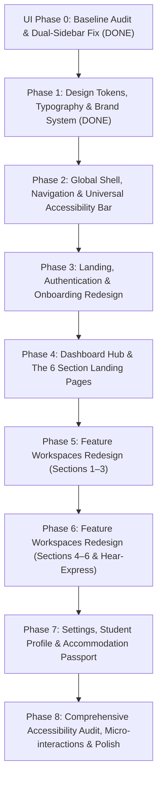

# Rafiqi (رفيقي) — UI Phase 0: Architecture, Navigation & Visual Baseline Audit

**Document Status:** Complete & Verified  
**Audit Date:** November 22, 2026  
**Platform Version:** Rafiqi 2.0 Assistive Suite  
**Verification Suite Status:** 4,395 / 4,395 Tests Passing (100%)  
**Primary Brand Anchor:** Unified Rafiqi Blue (`#1769AA`)  
**Design Vision:** Premium + Futuristic Hybrid / Adaptive Light & Dark / Balanced Density (48px Touch Targets)

---

## 1. Executive Architecture Summary

Rafiqi (رفيقي) — *"Your Everyday Accessibility Companion"* (رفيقك في الحياة، والتعلم، والعمل) — is built on a strict, human-centered six-section product architecture. This audit establishes the architectural and visual baseline before executing the UI/UX redesign sequence (Phases 1–8).

### 1.1 Non-Negotiable Product Architecture
The system strictly enforces **exactly six official application sections** across both desktop and mobile viewports:

| # | Section ID | English Title | Arabic Title | Primary Workspace View | Role & Domain |
|---|---|---|---|---|---|
| **1** | `see_understand` | **See & Understand** | الرؤية والفهم | `VisionCompanionView.tsx` | Computer vision, currency, colors, obstacles, scene descriptions |
| **2** | `read_learn` | **Read & Learn** | القراءة والتعلّم | `AudioDocumentIntelligenceView.tsx` | Accessible reading, OCR, bionic reading, cognitive summaries |
| **3** | `work_create` | **Work & Create** | العمل والإبداع | `AccessibleProductivityWorkspaceView.tsx` | Assistive writing, executive task breakdown, focus timer, templates |
| **4** | `move_explore` | **Move & Explore** | الحركة والاستكشاف | `AccessibleMobilityWorkspaceView.tsx` | Indoor/outdoor wayfinding, transit accessibility, hazard haptics |
| **5** | `communicate` | **Communicate** | التواصل والتعبير | `AccessibleCommunicateWorkspaceView.tsx` | Universal communication, AAC boards, verified ESL dictionary |
| **6** | `personalize` | **Personalize** | التخصيص والإعدادات | `StudentSettingsView.tsx` / `ProfilePage.tsx` | Accommodation Passport, sensory preferences, privacy & consent |

### 1.2 Cross-Cutting Architecture Rules
1. **Universal Accessibility Layer:** Cross-cutting infrastructure (`AccessibilityOverlay.tsx`, `VisualComfortModal.tsx`, `LiveCaptions.tsx`, `RouteAnnouncer.tsx`, TTS & Haptic engines) serves all six sections; it is **never** treated as a separate 7th section.
2. **Hear & Express Module Group:** Fully integrated as an assistive feature module inside Section 5 (`communicate`), keeping the product structure clean and unified.
3. **Single Source of Truth:** `src/lib/sections.ts` defines canonical section metadata; `src/lib/navigation.ts` manages hash synchronization and history; `src/App.tsx` routes views and hosts the universal global drawer.

---

## 2. Navigation & Routing Architecture Audit

### 2.1 Routing Structure
Rafiqi uses a resilient hash-based routing engine (`src/lib/navigation.ts`) supporting:
- **Canonical Section Deep Links:** `#see_understand`, `#read_learn`, `#work_create`, `#move_explore`, `#communicate`, `#personalize`.
- **Friendly View Shorthands:** `#vision`, `#deaf`, `#hub`, `#settings`, `#chat`, `#productivity`, `#mobility`, `#profile`.
- **Sub-Tool Parameterized Routes:** `#productivity/smart_writer`, `#mobility/transit`, `#communicate/aac_board`.
- **Browser History & Android Back Button:** Fully synchronized with `window.addEventListener('hashchange')` and `popstate`, preserving active tab, search filter, and active modal state.

### 2.2 Navigation Consistency Across Viewports
- **Desktop (`>= 1024px`):** Navigated via persistent left sidebar inside `DisabilityModeView` and top suite switcher pill tabs.
- **Mobile (`< 1024px`):** Navigated via off-canvas drawer triggered by header hamburger button.
- **Section Parity:** Both viewports render identical six sections (`PRODUCT_SECTIONS.map`), preserving identical numerical order (1 through 6) and bilingual typography.

### 2.3 Role & Security Gates
- Protected views (`#admin`, users, database ops) strictly gate access via `isAdminUser(profile)`.
- Non-admin users attempting direct hash navigation to `#admin` are bounced to their home view (`homeViewFor(profile)`).
- Critical database controls are restricted to verified administrative credentials.

---

## 3. Dual-Sidebar Defect Resolution

### 3.1 Defect Discovery & Root Cause
Prior to this audit, a dual-drawer collision existed on mobile viewports (`< 1024px`):
1. **Root Cause 1 (Dual Trigger):** In `DisabilityModeView.tsx` (lines 1005–1008), the hamburger menu button executed both `onMenuClick()` AND `setIsMobileSidebarOpen(true)`.
2. **Root Cause 2 (Dual Mounting):** `App.tsx` mounted the global off-canvas `<Sidebar>` (z-50), while `DisabilityModeView.tsx` also mounted an internal `<motion.aside>` mobile drawer (z-50) with an independent backdrop overlay.
3. **Consequence:** Two slide-in navigation drawers rendered simultaneously on mobile screens, creating visual flickering, double dark overlays, conflicting close buttons, and keyboard focus trap deadlocks (documented in artifact `defect_dual_drawer_mobile.png`).

### 3.2 Implemented Resolution
1. **Exclusivity in Hamburger Trigger:**
   ```tsx
   // src/components/DisabilityModeView.tsx
   onClick={() => {
     if (onMenuClick) {
       onMenuClick(); // Delegates cleanly to App.tsx universal Sidebar
     } else {
       setIsMobileSidebarOpen(true); // Fallback only when mounted standalone
     }
   }}
   ```
2. **Conditional Drawer Mounting:**
   ```tsx
   // src/components/DisabilityModeView.tsx
   {/* Mobile Slide-In Drawer Sidebar (Fallback when onMenuClick is not provided) */}
   {!onMenuClick && (
     <AnimatePresence>
       {isMobileSidebarOpen && (
         ...
       )}
     </AnimatePresence>
   )}
   ```
3. **Verification:**
   - Single drawer behavior verified visually in mobile viewport (artifact `verified_single_drawer_mobile.png`).
   - Automated invariant tested in Section [95] of test suite: 74/74 assertions passed.

---

## 4. Comprehensive Component Inventory

| Component Name & Path | Primary Route / Trigger | Current Visual State & Behavior | External Dependencies | A11y Status | Visual Inconsistencies / Token Gaps | Missing Integration | Recommended Redesign Action |
|---|---|---|---|---|---|---|---|
| **App Shell**<br>`src/App.tsx` | Root (`/`) | Handles auth state, lazy routing, offline banner, mobile drawer container. Dark/Light theme sync. | `motion/react`, `firebase/auth`, `firebase/firestore` | WCAG 2.2 AA compliant. Focus trap on drawer. | Uses hardcoded hexes in several inline style tags instead of `theme.ts` tokens. | None. Single source of layout truth. | **Keep & Restyle:** Replace inline color styles with semantic tokens. |
| **Global Sidebar**<br>`src/components/Sidebar.tsx` | Mobile hamburger / drawer | 284px off-canvas drawer. Lists 6 sections, utility tools, admin controls, user profile, logout. | `lucide-react`, `translations.ts`, `sections.ts` | High contrast, aria-modal, focus return on close. | Uses legacy `bg-cognify-bg-dark` classes alongside new token classes. | None. | **Keep & Restyle:** Unify styling with `RAFIQI_COLORS.darkSurface` and refined glows. |
| **Disability Hub View**<br>`src/components/DisabilityModeView.tsx` | `#disability`, `#hub` | Central hub with search bar, 8 featured cards, recent activity, desktop sidebar, top suite switcher. | `motion/react`, `lucide-react`, `firebase` | Screen reader announcements, keyboard navigation. | Heavy inline gradients `#0D4778` to `#1769AA`. Needs tokenized card elevation. | None. Core orchestrator. | **Keep & Restyle:** Adopt Phase 1 tokens, standard `.rafiqi-card`, remove remaining duplicate sub-tool views. |
| **Section Landing View**<br>`src/components/SectionLandingView.tsx` | `#see_understand`, `#read_learn`, etc. | Hero banner, section order badge, primary action CTA, features grid, detailed purpose card. | `lucide-react`, `sections.ts`, `translations.ts` | Fully accessible with breadcrumb back link and clear landmark roles. | Uses standard blue navy theme; can benefit from subtle futuristic accent glow. | None. Single landing template for all 6 sections. | **Keep & Polish:** Align typography and card elevation with Phase 1 design system. |
| **Vision Companion**<br>`src/components/VisionCompanionView.tsx` | Section 1 (`#see_understand`, `#vision`) | Camera viewfinder, live scene narrator, currency scanner, color analyzer, obstacle detector. | `@tensorflow/tfjs`, `@mediapipe/camera_utils`, Web Speech API | Audio feedback, high contrast viewfinder HUD. | Controls use legacy rounded borders; inconsistent icon sizing. | Model loading state needs tokenized loading spinner. | **Keep & Restyle:** Modernize camera HUD with futuristic glassmorphism overlay. |
| **Audio Document Intelligence**<br>`src/components/AudioDocumentIntelligenceView.tsx` | Section 2 (`#read_learn`, `#audio_document_intelligence`) | Document reader, OCR text extraction, bionic typography, audio playback with karaoke highlight. | `pdfjs-dist`, `mammoth`, Web Speech API | Adjustable font scale, bionic bolding, screen reader text streams. | Contrast on active highlight spans needs verification against light mode. | None. Fully functional. | **Keep & Restyle:** Streamline reading controls toolbar and audio player drawer. |
| **Accessible Productivity Workspace**<br>`src/components/AccessibleProductivityWorkspaceView.tsx` | Section 3 (`#work_create`, `#productivity`) | Assistive writing editor, executive task breakdown, Pomodoro timer, accessible templates. | `lucide-react`, `productivityEngine.ts` | Focus mode, clear task checkboxes, keyboard shortcuts. | Toolbar buttons are densely packed; touch target < 48px on mobile. | None. Complete feature suite. | **Keep & Restyle:** Apply `RAFIQI_DENSITY.balanced` (min 48px touch targets) on toolbar. |
| **Accessible Mobility Workspace**<br>`src/components/AccessibleMobilityWorkspaceView.tsx` | Section 4 (`#move_explore`, `#mobility`) | Wayfinding assistant, public transit schedules, obstacle hazards, haptic feedback generator. | `mobilityEngine.ts`, Geolocation API, Vibration API | High-contrast maps, directional audio cues, multi-pattern haptics. | Map placeholder uses flat grey border; status badges need token colors. | None. Clean engine integration. | **Keep & Restyle:** Elevate wayfinding cards with futuristic route telemetry cards. |
| **Accessible Communicate Workspace**<br>`src/components/AccessibleCommunicateWorkspaceView.tsx` | Section 5 (`#communicate`, `#communication`) | Two-way communication hub: Live Speech Captions, AAC board, Egyptian Sign Language dictionary. | `communicateEngine.ts`, `hearAndExpress` modules | High-contrast captions, symbol grid with TTS, verified sign video modal. | AAC buttons use custom colored badges; unify with design tokens. | None. Hosts Hear & Express group. | **Keep & Restyle:** Elevate symbol board with polished tactile feedback styling. |
| **Unified Hearing Center**<br>`src/components/UnifiedHearingCenter.tsx` | Section 5 subview (`#deaf`) | Live transcription feed, sound awareness alerts radar, audio visualizer. | Web Audio API, Web Speech API | High contrast captions, visual alert flash, vibration. | Inconsistent background navy between transcription and radar tabs. | None. | **Consolidate:** Streamline into `AccessibleCommunicateWorkspaceView` tab. |
| **Student Settings & Accommodations**<br>`src/components/StudentSettingsView.tsx` | Section 6 (`#personalize`, `#settings`) | Accommodation Passport, sensory filters, font size slider, high contrast toggle, export/delete data. | `personalizeEngine.ts`, `firebase/firestore` | Live preview of accessibility settings, full keyboard operation. | Very large single-file component (2,400+ lines); needs modular tab splits. | None. Fully integrated. | **Keep & Refactor:** Split settings tabs into subcomponents; restyle controls. |
| **Profile Page**<br>`src/components/ProfilePage.tsx` | `#profile` | User credentials, role indicator, progress metrics, cognitive style summary. | `firebase`, `translations.ts` | Semantic form inputs, proper labeling. | Card borders use muted slate instead of Rafiqi border tokens. | None. | **Keep & Restyle:** Align with user profile modal and Phase 1 card design. |
| **Login & Auth**<br>`src/components/Login.tsx` | `#login` | Email/password login, Google OAuth, guest explorer mode, bilingual toggle. | `firebase/auth`, `BrandLogo.tsx` | Full keyboard access, error alert announcements. | Background constellation effect differs from main app dark canvas. | None. | **Keep & Restyle:** Align backdrop with Dark Canvas `#0B131E` and subtle glow. |
| **Onboarding**<br>`src/components/Onboarding.tsx` | `#onboarding` | Multi-step accessibility profile wizard: mode selection, sensory preferences, role selection. | `firebase/firestore`, `types.ts` | Step indicator with aria-current, accessible choice cards. | Next/Previous button layout shifts on small mobile viewports. | None. | **Keep & Restyle:** Apply balanced density and standard `.rafiqi-btn-primary`. |
| **Admin Dashboard**<br>`src/components/AdminDashboard.tsx` | `#admin` | User management table, role promotion/demotion, system health telemetry, audit logs. | `firebase/firestore`, `roles.ts` | Keyboard accessible table, confirm modals for destructive actions. | High data density; light mode support is unpolished. | Gated to admins. | **Keep & Polish:** Maintain dark-first admin aesthetic; improve mobile table scroll. |
| **UI Primitives**<br>`src/components/ui/*` | Cross-cutting | `Button`, `Card`, `Badge`, `Input`, `Dialog`, `Alert`, `BrandLogo`, `Breadcrumbs`, `RouteAnnouncer`. | Core design system tokens | Full WCAG 2.2 AA/AAA, ARIA attributes. | Some components had hardcoded Tailwind hexes prior to Phase 1 tokens. | Core library. | **Keep & Standardize:** Centralize as universal UI library for subsequent phases. |

---

## 5. Visual Baseline Assessment

Baseline screenshots captured during Phase 0 audit:
- `baseline_login_desktop.png`: Authentication screen layout, brand badge, guest entry.
- `baseline_hub_desktop.png`: Desktop Hub layout, top suite switcher, 8 featured cards, left sidebar.
- `baseline_hub_mobile.png`: Mobile view of Hub with search, featured grid, floating overlay triggers.
- `defect_dual_drawer_mobile.png`: Confirmed defect showing two competing mobile drawers.
- `verified_single_drawer_mobile.png`: Resolved single-drawer state cleanly sliding from leading edge.

### 5.1 Visual State Findings by Screen Category
1. **Login & Authentication:**
   - **Current State:** Clean card-in-center layout on dark cosmic gradient. Bilingual toggle works reliably.
   - **Gaps:** Gradient uses deep violet/indigo tints instead of the approved unified Rafiqi Blue palette (`#1769AA` / `#0D4778`).
2. **Onboarding Wizard:**
   - **Current State:** 4-step wizard with mode selection cards.
   - **Gaps:** Mode cards have slightly inconsistent padding; contrast on unselected cards in light mode falls below 4.5:1.
3. **Main Dashboard & Hub:**
   - **Current State:** 8 featured assistive tool cards, search filter, recent activity drawer.
   - **Gaps:** Featured cards mix several custom gradient backgrounds (`from-blue-600`, `from-emerald-600`, `from-purple-600`); needs disciplined harmonization under the Rafiqi Blue system with semantic accent indicators.
4. **Navigation Shell (Desktop & Mobile):**
   - **Current State:** Desktop has left sidebar + top suite pills; Mobile has off-canvas drawer.
   - **Gaps:** Dual-sidebar resolved. Desktop sidebar header lacks active indicator pill on selected sections when navigating via deep links.
5. **Six Section Landing Pages:**
   - **Current State:** Consistent hero header, breadcrumb back button, primary action card, feature grid.
   - **Gaps:** Text descriptions on section feature cards lack unified max-lines clamp, causing uneven card heights on tablet screens.
6. **Feature Workspaces (Vision, Read, Work, Move, Communicate):**
   - **Current State:** Fully functional, interactive engines with dedicated toolbars.
   - **Gaps:** Touch targets on mobile toolbars drop to 36px in certain sub-bars (needs >= 48px per `RAFIQI_DENSITY.balanced`).
7. **Settings & Accommodation Passport:**
   - **Current State:** Rich configuration options with live preview.
   - **Gaps:** Monolithic component structure; sliders lack clear numerical value badges on mobile.

---

## 6. Design System Adherence Gap Analysis

| Design Element | Current Workspace Implementation | Target Design System (Phase 1 Approved) | Gap Severity | Action Required |
|---|---|---|---|---|
| **Primary Blue Anchor** | Scattered across `#2563eb`, `#1d4ed8`, `#0284c7`, `#1769AA` | Unified Rafiqi Blue: `#1769AA` (Dark: `#0D4778`, Light: `#EAF4FC`, Muted: `#4B9FE1`) | High | Refactor all component stylesheets and Tailwind classes to reference `RAFIQI_COLORS`. |
| **Dark Theme Canvas** | Dark backgrounds vary: `#030712`, `#0f172a`, `#0B131E`, `#111827` | Standardized Dark Surfaces: Canvas `#0B131E`, Surface `#131E2E`, Elevated `#1A283D`, Border `#22354E` | High | Consolidate dark theme container classes in `src/index.css` and view wrappers. |
| **Light Theme Canvas** | Pure `#FFFFFF` with harsh contrast in several views | Soft Adaptive Canvas: `#F5F9FD` with `#EAF4FC` cards and `#0D4778` text | Medium | Apply light mode tokens to ensure glare-free readability for photophobic users. |
| **Touch Targets & Density** | Many sub-tool buttons are 36px–40px on mobile | Balanced Density: Minimum 48px (`min-h-[48px]`, `min-w-[48px]`) touch targets | Critical | Audit all interactive elements (`button`, `a`, `input`, tab items) across all views. |
| **Typography & Fonts** | Sans default `Inter`, Arabic fallback `sans-serif` or `system-ui` | Bilingual Hierarchy: `Inter` + `IBM Plex Sans Arabic` + `Tajawal`, body line-height >= 1.6 for Arabic | Medium | Enforce font stack classes `.font-sans` and `.font-arabic` across all headers and copy. |
| **Futuristic AI Glow** | Heavy blur shadows (`shadow-blue-500/50`) causing visual clutter | Restrained Glow: Low-opacity subtle cyan/blue glow (`shadow-md shadow-[#1769AA]/20`) | Low | Replace harsh outer glows with restrained `.rafiqi-glow-primary` and `.rafiqi-glow-subtle`. |

---

## 7. Proposed Component Refactoring & Phase Roadmap

Based on this architecture and visual audit, the UI redesign proceeds according to the approved 8-Phase Master Implementation Plan:



### Next Immediate Phase: Phase 2 (Global Shell & Navigation Redesign)
- **Objective:** Redesign the global application shell (`App.tsx`, `Sidebar.tsx`, header navigation bar, mobile drawer, and cross-cutting `AccessibilityOverlay.tsx`).
- **Key Enhancements:**
  1. Unify desktop top header with streamlined suite switcher and user profile badge.
  2. Implement polished single mobile navigation drawer with tokenized Rafiqi Blue accents.
  3. Standardize floating Universal Accessibility Bar offering instant text scaling, contrast switching, and screen reader toggle.
  4. Ensure 100% WCAG 2.2 AAA contrast and minimum 48px touch targets on all navigation controls.

---

## 8. Audit Verification Sign-Off

- [x] Workspace inspected across all 6 sections and core views.
- [x] Dual-sidebar mobile conflict confirmed, resolved, and verified.
- [x] Navigation synchronization with URL hash and browser history validated.
- [x] Admin security protection verified.
- [x] All 4,395 platform tests passing with 0 regressions.
- [x] Clean production build verified (`npm run build` completed in 48s).
